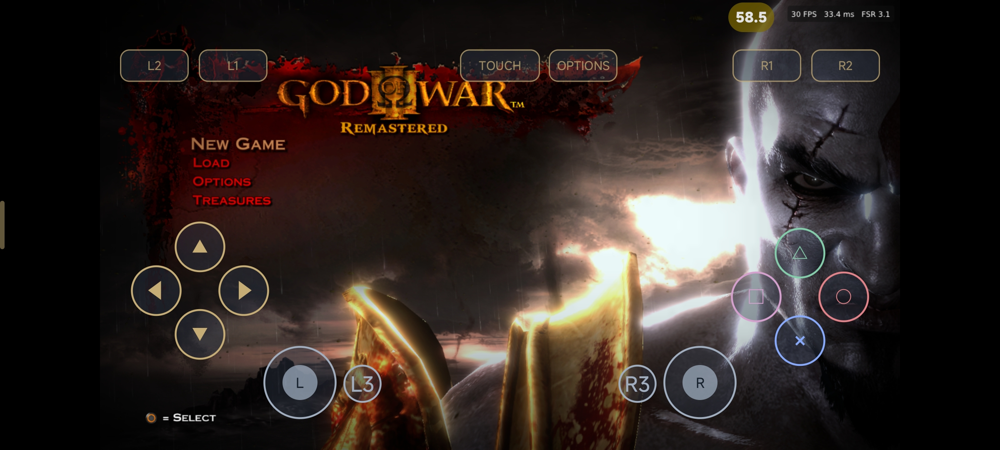
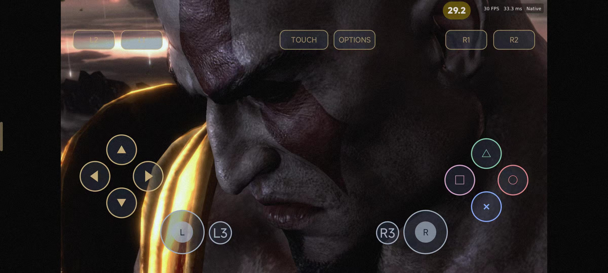

# God of War III — Daedalus Fork

Daedalus Fork maintained by erickmendes22. Based on the Android work by zFitness and the upstream contributors.

**Version: 2.1.6-android3** · [YouTube: @daedalusemulator](https://www.youtube.com/@daedalusemulator) · [Base: zFitness/gow3_android](https://github.com/zFitness/gow3_android)

[Português (Brasil)](README.md) | **English**

  
  

This document is an English translation of the repository README.

The **Android / ARM64 port** of *God of War III Remastered* (PlayStation 4) — under development, see below.

The game's original executable is x86-64 (the PS4 uses the same architecture). On an Android
device the game code is dynamically translated by **FEXCore** and runs on ARM64; a runtime
written specifically for this game replaces the PS4 system libraries, and the graphics are
translated to Vulkan (connecting to the Adreno GPU through the Turnip driver). It is not a
generic emulator: the whole project serves this one game. This project forks the
[R-V-L port](https://github.com/R-V-L/gow3_pc), which is based on
[deadinside28's bloodborne_pc](https://github.com/deadinside28/bloodborne_pc), and merges the
God of War III fixes from [cuesta4's shadPS4 fork](https://github.com/cuesta4/shadPS4)
(see [Acknowledgments](#acknowledgments)).

> **This project contains no game files.** You need game files dumped from your own PS4
> (currently tested against CUSA01740, version 01.02).
> This project is not affiliated with Sony Interactive Entertainment or Santa Monica Studio.
> God of War is a trademark of Sony Interactive Entertainment.

## Quickstart

The full tutorial from getting the project to running debug (Android port, macOS Apple Silicon
host) is in **[docs/QUICKSTART.md](docs/QUICKSTART.md)**.

## Performance

The Android side is still being validated on real devices; no stable performance numbers yet.

## Implemented Features

- **Runtime chain**: the x86-64 game code runs on ARM64 through FEXCore (`cpu/`,
  `libgow3cpu.so`), and the graphics are translated to Vulkan by the ARM64 build of the
  shadPS4 graphics core (`libgow3gpu.so`), connected to the Adreno GPU via Turnip.
- **Kotlin/Compose launcher** (`android-launcher/`): installs the runtime (SHA-256
  validation), manages the Surface, input, audio, settings and process lifecycle.

- Reuses the same game runtime, PS4 system library reimplementation, graphics core and patch
  logic as the desktop build; the Android side is currently being validated on real devices,
  and the resolution, FPS and cheats patches have not passed byte-level validation yet.

## System Requirements

- **ARM64 (arm64-v8a) Android device**, no root required.
- A Vulkan-capable GPU with a reasonably recent driver (Turnip; Adreno devices).
- Your own game copy: **CUSA01740 with the 01.02 update applied** (a folder containing
  `eboot.bin`, `sce_module`, `sce_sys`). No game files are included in the downloads.

Building the Android side requires a host machine (the current flow is based on macOS Apple
Silicon); dependencies and steps are in [docs/QUICKSTART.md](docs/QUICKSTART.md).

## How It Works

| Module | Location | Purpose |
| ------ | -------- | ------- |
| Prepare | `scripts/` | Reads `eboot.bin`, applies relocations, links the game's bundled `libc` and `libSceFios2` into a single image |
| Loader | `src/probe.c` | Loads the image, installs validated hooks (cheats, multipliers, health bars), starts the game's original code |
| Runtime | `src/runtime_*.c` | Reimplements PS4 system functions: memory, threads, files, audio, video, gamepad, saves and services |
| GPU | `gpu/shadps4/` | shadPS4 graphics core, translates PS4 GPU instructions to Vulkan, includes this port's performance optimizations (background shader cache, deferred readback) |
| In-game menu | `gpu/shim/gow3_overlay.cpp` | Dear ImGui menu and performance overlay; settings live in `gpu/shim/gow3_settings.cpp` |
| Patches | `patches/God_of_War_III_Remastered.xml`, `scripts/patches.py` | Applied in memory at startup, never modify game files |
| Launch | Android launcher (`android-launcher/`), `run.sh` | The Android side prepares the image and starts `gow3-probe` via the launcher; `run.sh` is the desktop launch entry point |

More docs: [Mods](docs/MODS.md), [Upscaler & frame generation](docs/upscaler.md),
[Parallel GPU work](docs/parallel_gpu.md) and the [Roadmap](docs/gow3/ROADMAP.md).

## Acknowledgments

This project forks R-V-L's Linux port, which in turn derives from FelipePrado0's original
project:

- **deadinside28**: [bloodborne_pc](https://github.com/deadinside28/bloodborne_pc), the original native port.
- **gow3_pc** (R-V-L): [bloodborne_pc for Windows](https://github.com/R-V-L/gow3_pc),
  the branch this project is based on.
- **cuesta4**: [shadPS4 fork focused on God of War III Remastered](https://github.com/cuesta4/shadPS4)
  (branch `eltutz`). This port uses its GNM hybrid rewrite, depth/stencil state and image alias fixes.
- **shadPS4 team**: [shadPS4](https://github.com/shadps4-emu/shadPS4) renderer.
- **fexdroid**: [fexdroid](https://github.com/cobrabm12/fexdroid)

Patches: kvicken and cuesta4 (resolution, texture fixes, 120 FPS and video skipping, based on
illusion0001's PS3 patches), published in shadPS4's
[shadps4-emu/ps4_cheats#145](https://github.com/shadps4-emu/ps4_cheats/pull/145) and adapted
for this executable. The 240 FPS patch was adapted from the 120 FPS patch by Felipe Prado. The
cheats are adapted from Celogamez's
[GoldHEN cheats](https://github.com/GoldHEN/GoldHEN_Cheat_Repository).

Also used: [LibAtrac9](https://github.com/Thealexbarney/LibAtrac9), [FFmpeg](https://ffmpeg.org),
[SDL3](https://github.com/libsdl-org/SDL), [Dear ImGui](https://github.com/ocornut/imgui),
[sirit](https://github.com/shadps4-emu/sirit), [magic_enum](https://github.com/Neargye/magic_enum),
[miniz](https://github.com/richgel999/miniz), [xbyak](https://github.com/herumi/xbyak),
[Vulkan Memory Allocator](https://github.com/GPUOpen-LibrariesAndSDKs/VulkanMemoryAllocator),
[FSR-Vulkan](https://github.com/FireBurn/FSR-Vulkan) and the AMD FidelityFX SDK,
[LLVM](https://llvm.org) and [Pillow](https://python-pillow.org).

## License

GNU GPL v2 or later (see [LICENSE](LICENSE)). Third-party components retain their own licenses.
